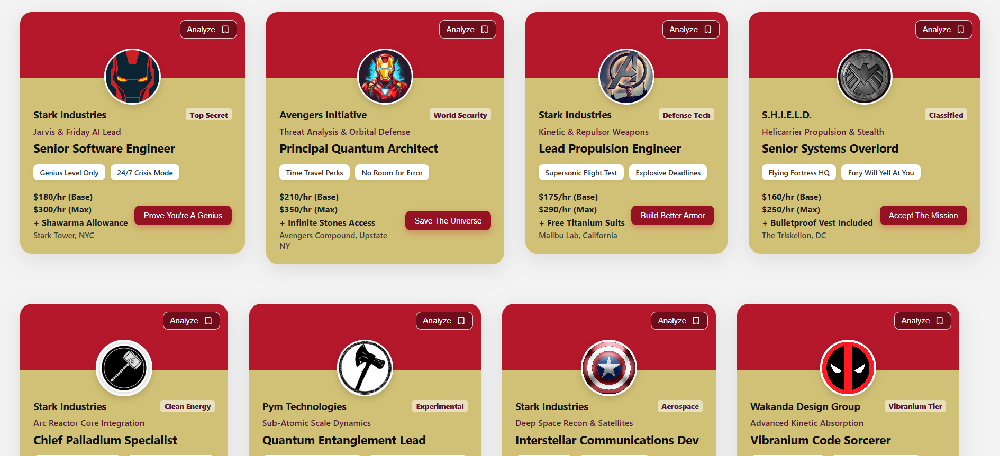
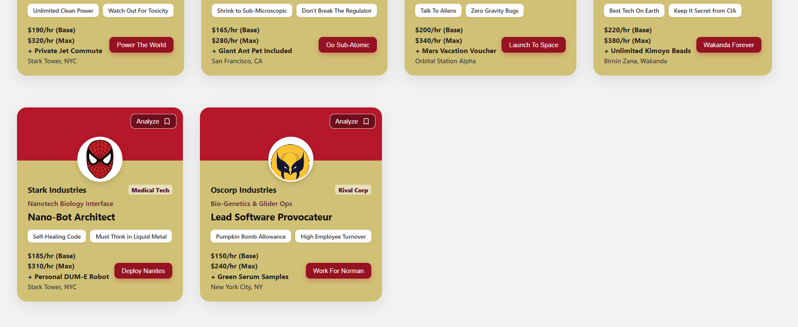

# ⚡ Stark Industries Job Portal

A modern, responsive React.js mini-project showcasing fictional job openings at Stark Industries and the Marvel Cinematic Universe, built with custom CSS Flexbox layouts and reusable components.

## 📸 App Preview

## 🚀 Features
- **Reusable Component Architecture:** Built using modular React components (`Card.jsx`).
- **Dynamic Grid & Flexbox Layout:** Perfectly responsive side-by-side card arrangement that wraps smoothly across different screen sizes.
- **MCU Theme:** Styled with a classic Iron Man red-and-yellow color palette, custom avatar profiles, and high-tech typography.
- **Interactive UI:** Features action buttons, requirement badges, and modern card shadows.

## 🛠️ Tech Stack
- **React.js** (with Vite)
- **JavaScript (ES6+)**
- **CSS3** (Flexbox, Custom Styling)
- **Lucide React** (for icons)

## 📦 Getting Started

Follow these steps to run the project locally:

1. Navigate to the project directory:
   cd .\04-cards-project\

2. Install dependencies:
   npm install
   
4. Run the development server:
   npm run dev
